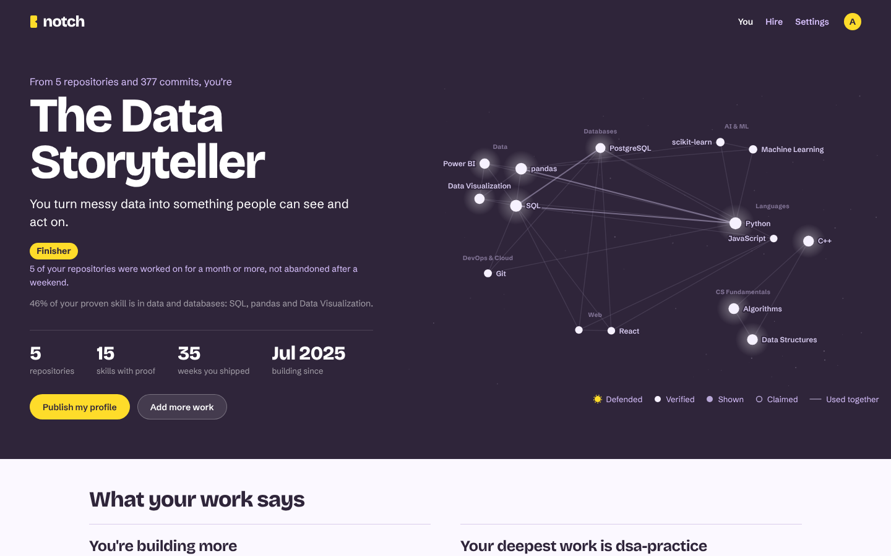
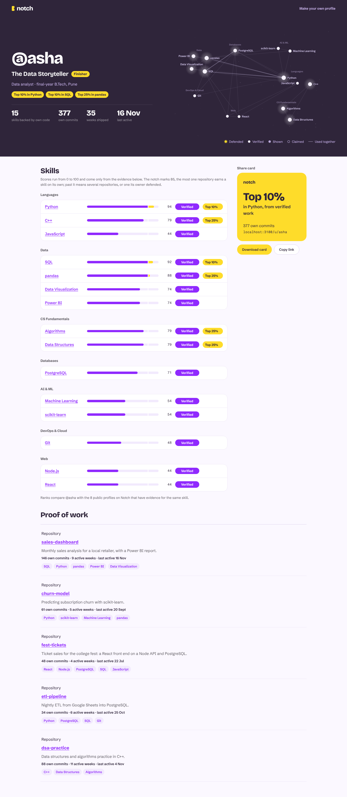
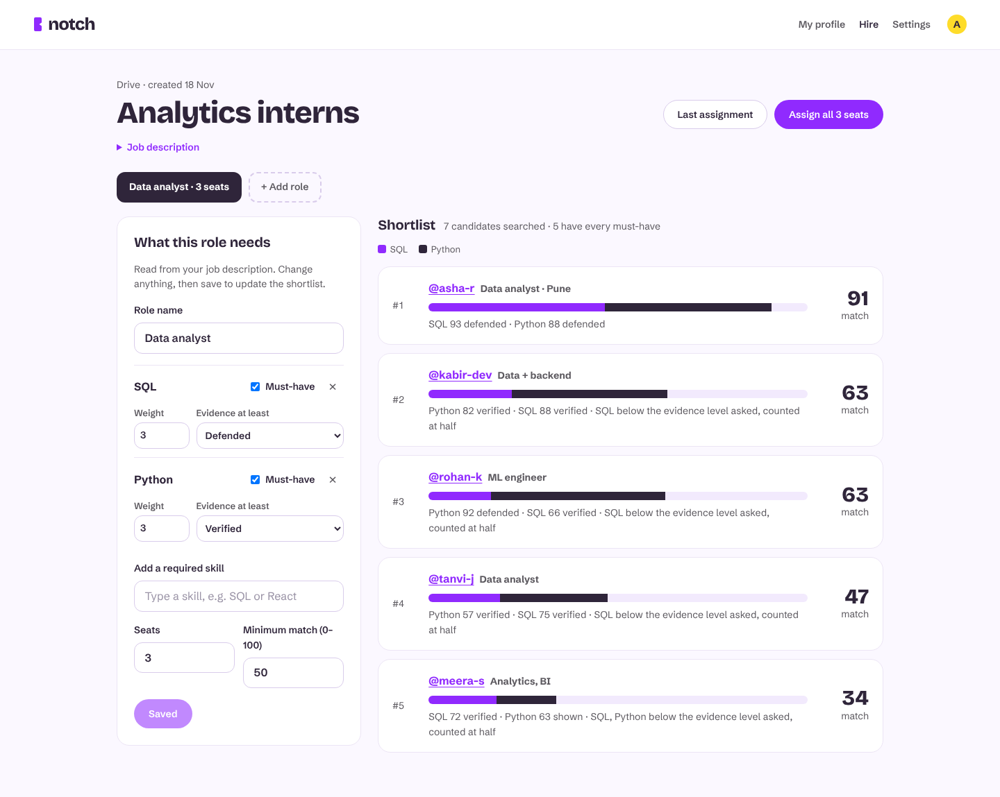
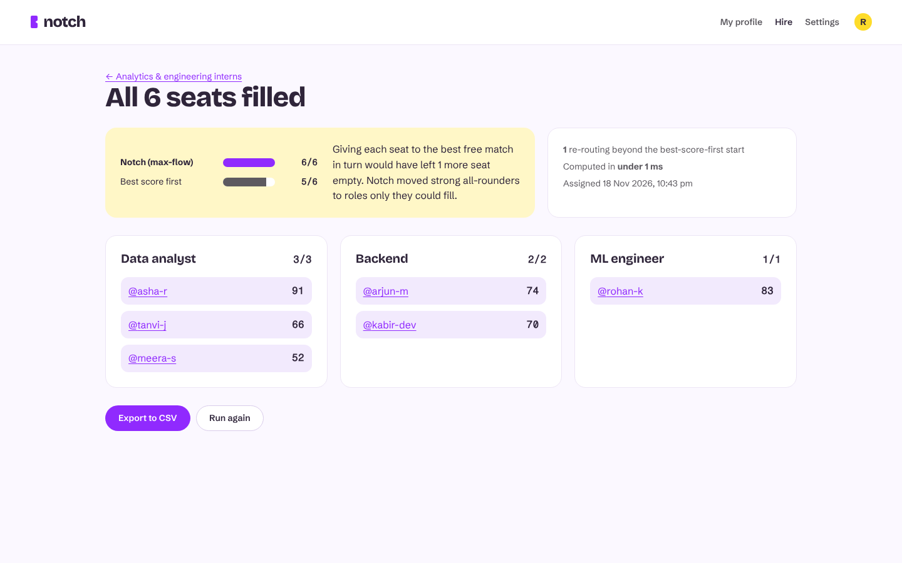

# Notch

[](https://github.com/dhruvi-git/notch/actions/workflows/ci.yml)

**You wrote it. Now prove it.** Notch reads a student's work and tells them who they are as a
builder. Connect GitHub, or paste what ChatGPT or Claude remembers about you, and in under a
minute Notch draws your skills as a **constellation** (one star per skill, joined where you used
skills together), names your **archetype** (The Data Storyteller, The Product Builder…) and how
you work (Night Owl, Finisher…), and puts what you *talk* about next to what you *build* with:
your learning edges and your quiet strengths. Every insight comes from a count it can point to.

The strongest proof is an **Ownership Check**: a timed interview about your own repository in
which Notch picks parts of your code and asks you to explain them. Pass, and the repository is
**Defended**, with a public transcript recruiters can read. Recruiters paste a job description,
get a ranked shortlist with the proof attached, and fill every seat across several roles at once.

CIA 3 project for Advanced Algorithm, Semester V, B.Tech CS AI & ML (2026–27).

## Screens

| | |
|---|---|
|  |  |
| You: your constellation, archetype and trait, drawn from your own work | Said vs done: what you talk to AI about, against what you build |
|  |  |
| Bring in your AI history with one prompt, no export file | The public profile recruiters and friends see |
|  |  |
| An Ownership Check: explain your own code against the clock | The verdict: the Defended seal, then how every answer was graded |
|  |  |
| The public transcript of a defence | A drive: roles from the job description, a ranked shortlist |
|  |  |
| Landing | Seat assignment: max-flow against best score first |

Screenshots use the mock API's sample candidates (`web/scripts/mock-portfolio.mjs`).

## The algorithms

All self-implemented in plain Java 21 (`engine/`), called by the API; the web app never computes
a score or an assignment.

| Decision | Algorithm | Syllabus |
|---|---|---|
| Who fills which seat across several roles, filling as many as possible | Edmonds–Karp max-flow, warm-started from greedy (`flow/MaxFlow`, `flow/SeatAssigner`) | Unit 5 · CO4 |
| Percentile cut-offs behind "Top 10% in SQL" badges; top-k shortlists | Randomized Quickselect, three-way partition (`select/RandomizedSelect`, `score/PercentileBands`) | Unit 6 · CO5 |
| Is a connected repository a copy of someone else's? | Bloom filter, then an exact check (`probabilistic/BloomFilter`, `api/.../DuplicateScreen`) | Unit 6 · CO5 |
| Skill names and autocomplete | Radix tree (`text/RadixTree`, `api/.../SkillCatalog`) | Unit 4 |
| Which parts of a repository an Ownership Check asks about, so a few questions touch every skill, concept and main file | Greedy weighted set cover, H(d)-approximate (`cover/GreedySetCover`, `api/.../QuestionPlanner`) | Unit 5 · CO4 |

On a synthetic campus drive, max-flow fills 100% of seats where best-score-first greedy fills
81%; a 10,000-candidate drive takes about 60 ms. Results and method: [docs/benchmarks.md](docs/benchmarks.md).

## Repository layout

| Path | What it is |
|---|---|
| `engine/` | Self-implemented algorithms, tests and benchmarks. Plain Java 21, no framework |
| `api/` | Spring Boot REST API: portfolios, GitHub and chat-export evidence, public profiles, hiring drives, shortlists, seat assignment ([api/README.md](api/README.md)) |
| `web/` | Next.js web app: landing, profile builder, public profiles, recruiter drives and assignments ([web/README.md](web/README.md)) |
| `guard/`, `explain/`, `cli/` | Earlier code-review and decision-ledger features, still available under `/projects` in the web app |
| `docs/` | Benchmark results and design notes |
| `samples/` | Sample ChatGPT and Claude exports |

**First time?** Follow [`RUNNING.md`](RUNNING.md): setup, tests, and what to do if something fails.

## Prerequisites

- JDK 21
- Maven 3.9 or newer
- Docker Desktop (for the local database)
- Node 20.9 or newer (for the web app)
- Optional: `GITHUB_TOKEN` (any personal token, no scopes) to read up to 30 repositories per sync instead of 12

## Run it

```bash
docker compose up -d                              # PostgreSQL
mvn -q install -DskipTests
mvn -pl api spring-boot:run                       # API on :8090

curl -X POST "localhost:8090/api/dev/demo-pool?size=300"   # 300 sample public candidates (local profile)

cd web && npm ci && npm run dev                   # http://localhost:3000
```

Without Java, `npm run mock-api` and `npm run dev` in `web/` run the whole interface against an
in-memory stand-in with a sample candidate pool.

## Run the tests

```bash
mvn test                  # Java: engine and API
cd web && npm run typecheck && npm run build
```

## Run the benchmarks

```bash
mvn -q -pl engine compile
java -Xmx2500m -cp engine/target/classes dev.notch.engine.bench.BenchmarkRunner
```

The latest results are in [`docs/benchmarks.md`](docs/benchmarks.md).
