<div align="center">

# notch

### You wrote it. Now prove it.

Notch reads a student's real work, draws their skills as a constellation, and lets them **defend
their own code** in a timed interview. Recruiters get a ranked shortlist with the proof attached,
and fill every seat across several roles at once.

[](https://github.com/dhruvi-git/notch/actions/workflows/ci.yml)


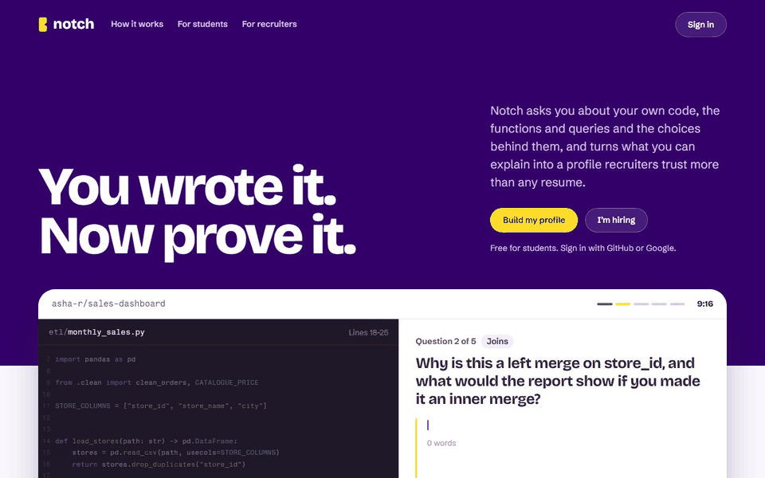

**[See it work](#see-it-work)** · **[Features](#key-features)** · **[Features → algorithms](#features--algorithms)** · **[The algorithms](#the-algorithms-in-depth)** · **[Animation](#motion-and-animation)** · **[Tech stack](#tech-stack-and-architecture)** · **[Run it](#run-it-locally)**

</div>

---

## Why Notch

A resume says "SQL, Python, Power BI". Anyone can type that. Notch replaces the claim with
evidence, and gives every piece of evidence a level that says how much it can be trusted:

| Level | What it takes | Score ceiling |
|---|---|---|
| ○ **Claimed** | You typed it in | 0 |
| ◌ **Shown** | Something exists: a project write-up, a chat history, a thin repository | low |
| ● **Verified** | A repository with at least 5 of *your own* commits across at least 2 weeks | 85 from one repository |
| ✸ **Defended** | You passed an **Ownership Check**: explained your own code, live, against the clock | 100 |

Everything else in the product (the constellation, the archetype, percentile badges, shortlists,
seat assignment) is computed from those levels, by algorithms implemented from scratch in
[`engine/`](engine/).

> CIA 3 project for **Advanced Algorithms**, Semester V, B.Tech CS (AI & ML), 2026–27.

---

## See it work

<table>
<tr>
<td width="50%" valign="top">

**1 · Connect GitHub → your constellation draws itself**

Notch reads your public repositories (your own commits only, forks left out), scores every
skill, names your archetype and trait, and reveals the sky strongest star first.

</td>
<td width="50%" valign="top">

**2 · Defend a repository in an Ownership Check**

Greedy set cover picks five parts of *your* code. You explain them in your own words in 12
minutes. Score 70 or more and the seal stamps: the repository is **Defended**.

</td>
</tr>
<tr>
<td>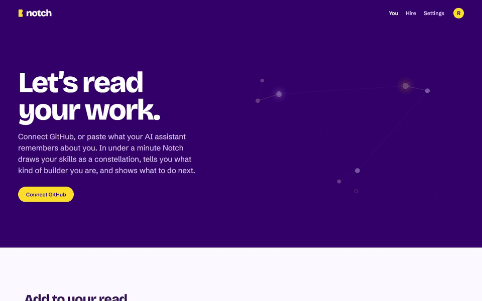</td>
<td>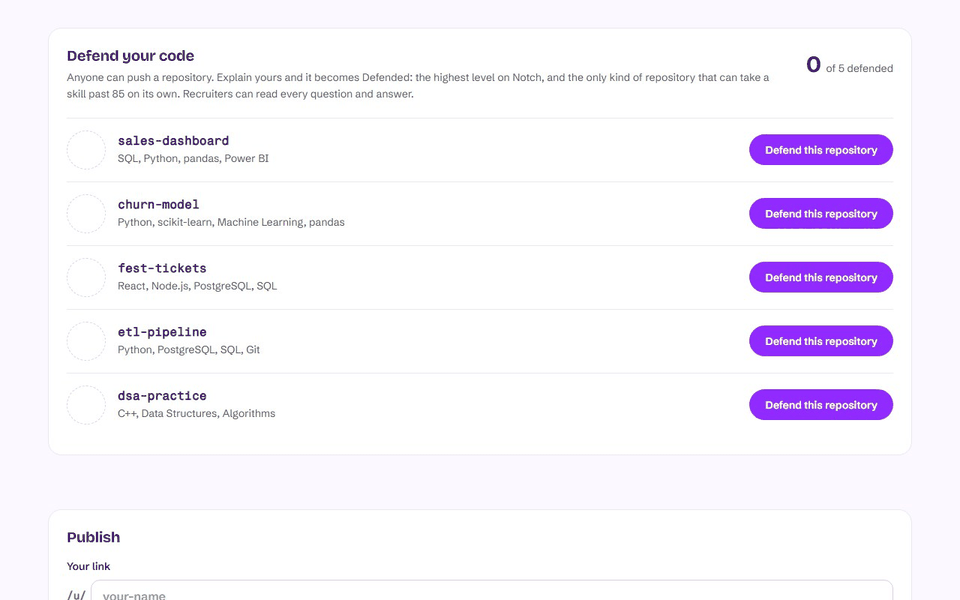</td>
</tr>
</table>

**3 · Hire: paste a job description, get a shortlist, assign every seat**

The job description becomes weighted requirements. Each role gets a ranked shortlist with a
per-skill breakdown. **Assign all seats** runs min-cost max-flow across every role. In this
clip, best-score-first fills **3 of 4** seats and Notch fills **4 of 4**, because it moves the
all-rounder to the role only they can fill.

<div align="center">
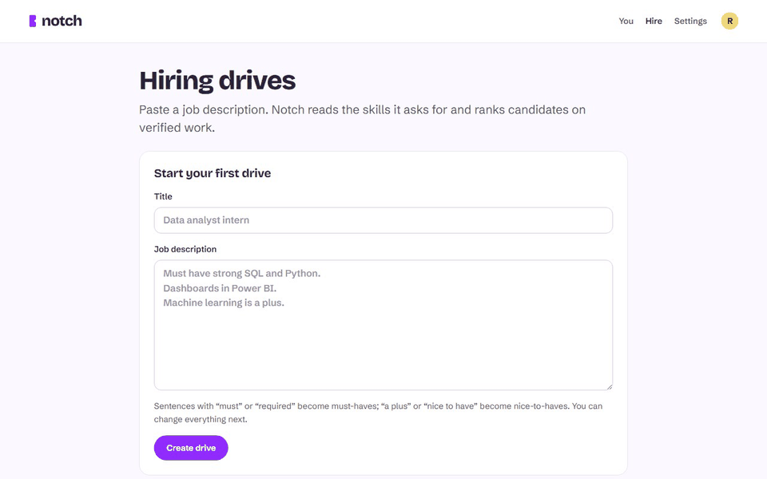
</div>

<sub>Clips are recorded from the real web app running against the bundled mock API
(`web/scripts/mock-api.mjs`) and its sample candidates, so they can be re-made without
GitHub or AI keys.</sub>

<details>
<summary><b>More screens</b> (still images)</summary>

| | |
|---|---|
|  | 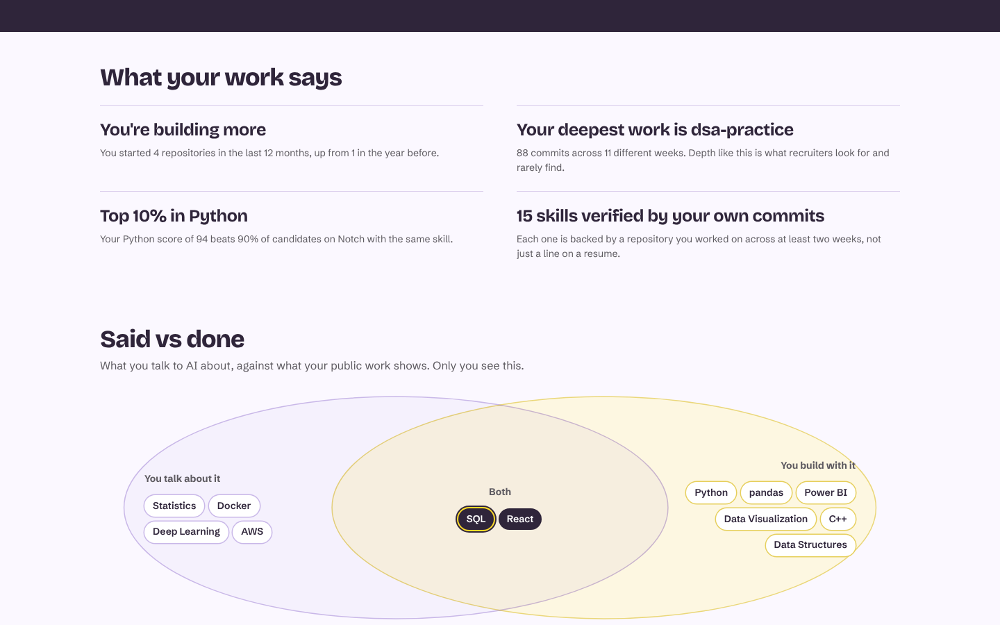 |
| **You:** constellation, archetype and trait | **Said vs done:** what you ask AI about, next to what you build |
| 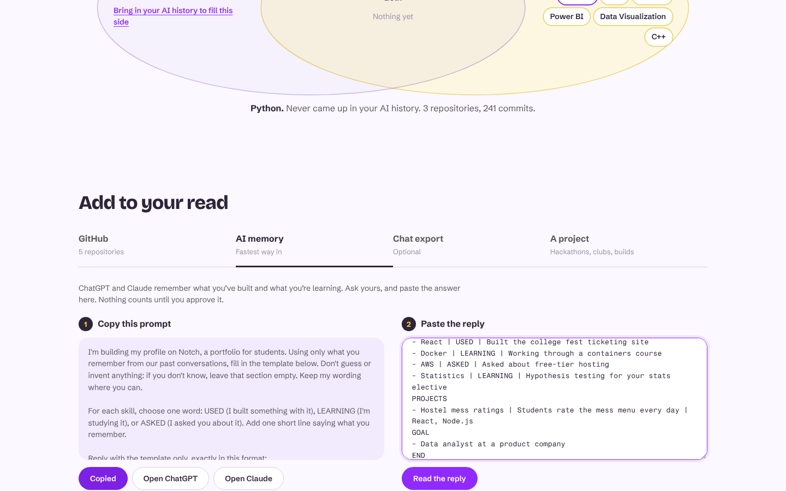 |  |
| Bring in your AI history with one prompt, no export file | The public profile recruiters see |
| 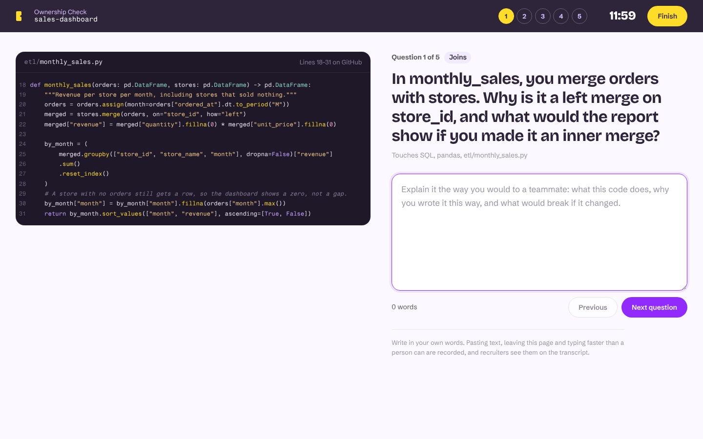 | 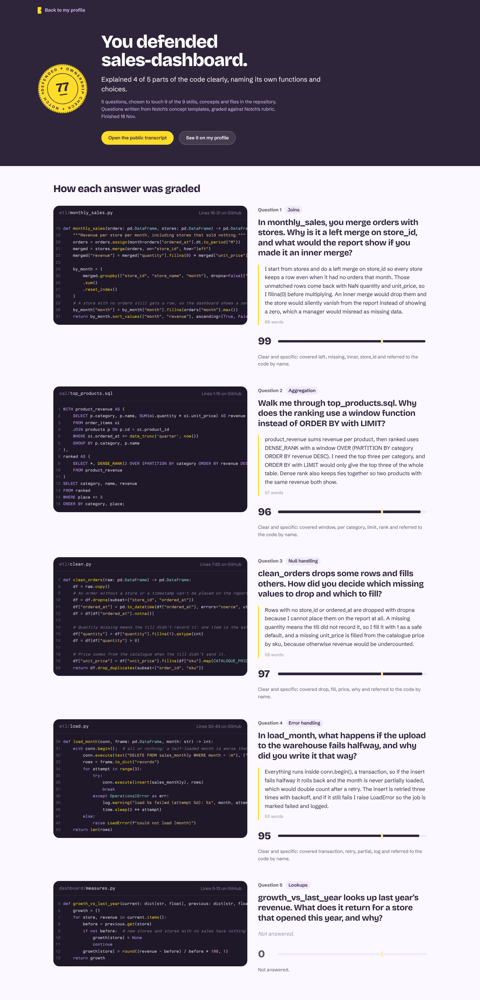 |
| An Ownership Check against the clock | The verdict and how every answer was graded |
| 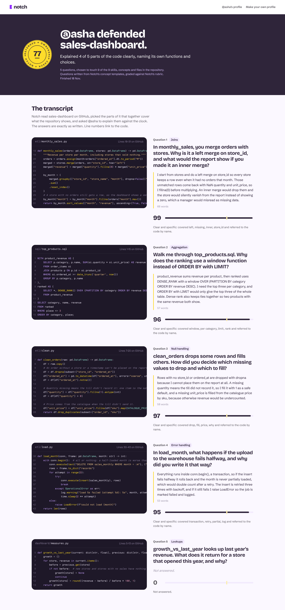 |  |
| The public transcript of a defence | A drive: roles from the job description, a ranked shortlist |
| 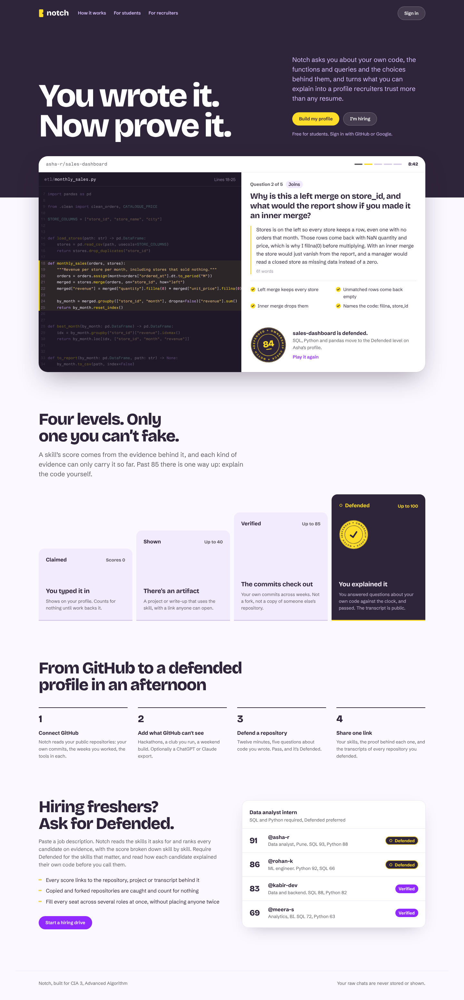 |  |
| Landing | Seat assignment compared with best-score-first |

</details>

---

## Key features

### For students

- **Your read in under a minute.** Connect GitHub and Notch counts *your* commits, the distinct
  weeks you worked, and the languages, topics and tools in each repository. Forks, and
  repositories without your commits, are counted out.
- **Constellation.** One star per skill: size is the score, fill is the evidence level, and lines
  join skills you used in the same repository. Skills cluster by area (Data, Web, AI & ML…).
- **Archetype and trait.** *The Data Storyteller*, *The Model Builder*, *The Product Builder*,
  *The Systems Engineer*, *The Mobile Maker*, *The Problem Solver*, *The Polymath* or *The
  Explorer*, plus how you work: *Night Owl*, *Early Bird*, *Weekend Builder*, *Steady*,
  *Sprinter* or *Finisher*. Every sentence comes from a count it can point to.
- **What your work says.** Up to four plain-English findings, such as "Top 10% in Python" or
  "Your deepest work is dsa-practice: 88 commits across 11 weeks".
- **Said vs done.** A Venn diagram of what you talk to AI about against what you build:
  learning edges on one side, quiet strengths on the other. Only you see it.
- **AI memory import.** Copy one prompt into ChatGPT or Claude and paste the reply back, or
  upload a chat export. Nothing counts until you approve it, and chat evidence is worth at most a
  fifth of a strong repository.
- **Ownership Check.** A 12-minute, 5-question interview about your own code. Passing makes the
  repository **Defended**, lifts its score cap from 85 to 100, and publishes the transcript.
- **Public profile and share card.** `/u/<handle>` with your skills, levels, percentile badges and
  defence transcripts, plus a downloadable card.
- **Inbox.** Recruiters' messages arrive in Notch (and by email when mail is set up); you answer
  *interested* or *not now*.

### For recruiters

- **Job description → requirements.** "Must"/"required" sentences become must-haves (weight 3,
  Verified expected), "a plus"/"nice to have" become nice-to-haves (weight 1), everything else is
  weight 2. Every requirement is editable before anything runs.
- **Ranked shortlist with proof.** A 0–100 match per candidate, with each skill's contribution
  drawn as a stacked bar, and the evidence level behind it.
- **Near misses.** For candidates just under the bar, the *single smallest fix* that would get
  them over it: raise one skill's score, or reach the required evidence level.
- **Several roles, one drive.** Up to 10 roles with their own seats and minimum match.
  **Assign all seats** fills as many as possible and, among those, picks the best total fit.
- **Outreach.** A drafted message built from the candidate's evidence, sent to their inbox.

### For developers (the earlier decision-ledger tools, still under `/projects`)

- **Recall.** Hybrid exact + semantic search over your ChatGPT / Claude / Claude Code history,
  with cited answers and a "why this matched" breakdown.
- **Decision ledger and drift alerts.** Decisions are extracted from chats. Notch flags when later
  work goes against one ("we ruled out MongoDB" → `npm install mongoose`).
- **Guard and MCP.** The `notch` CLI blocks commits and agent edits that break a decision, gives
  Claude Code / Codex / Cursor the project's memory over MCP, and writes `AGENTS.md` / `CLAUDE.md`
  context packs ([cli/README.md](cli/README.md)).
- **Code map and review.** Upload a codebase to get its areas, start-here files and a review.

---

## Features → algorithms

Every algorithm below is written from scratch in plain Java 21 in [`engine/`](engine/), with no
runtime dependencies. The API calls them, and the web app never computes a score or an assignment.

| Feature | Algorithm(s) | Where | Syllabus |
|---|---|---|---|
| **Seat assignment** across every role in a drive | **Min-cost max-flow** (successive shortest paths, Bellman–Ford + Dijkstra with Johnson potentials) for the saved result; **Edmonds–Karp max-flow** and **best-score-first greedy** run alongside for the comparison | [`flow/MinCostFlow`](engine/src/main/java/dev/notch/engine/flow/MinCostFlow.java), [`flow/MaxFlow`](engine/src/main/java/dev/notch/engine/flow/MaxFlow.java), [`flow/SeatAssigner`](engine/src/main/java/dev/notch/engine/flow/SeatAssigner.java) → [`recruit/core/Matching`](api/src/main/java/dev/notch/api/recruit/core/Matching.java) | Unit 5 · CO4 |
| **Ownership Check**: which code to ask about | **Greedy weighted set cover**, H(d)-approximate | [`cover/GreedySetCover`](engine/src/main/java/dev/notch/engine/cover/GreedySetCover.java) → [`ownership/core/QuestionPlanner`](api/src/main/java/dev/notch/api/ownership/core/QuestionPlanner.java) | Unit 5 · CO4 |
| **"Top 10% in SQL"** percentile badges | **Randomized Quickselect** (3-way partition), nested cut-offs | [`score/PercentileBands`](engine/src/main/java/dev/notch/engine/score/PercentileBands.java) → [`portfolio/CandidatePool`](api/src/main/java/dev/notch/api/portfolio/CandidatePool.java) | Unit 6 · CO5 |
| **Shortlist top-k**, near misses, "where you stopped" tasks, start-here files, review file picks | **Randomized Quickselect** top-k | [`select/RandomizedSelect`](engine/src/main/java/dev/notch/engine/select/RandomizedSelect.java) → `RecruitService`, `TaskPrioritizer`, `CodeMapBuilder`, `SearchPipeline` | Unit 6 · CO5 |
| **Copied-repository screen**: one project cannot verify two people | **Bloom filter** (double hashing) + exact confirm | [`probabilistic/BloomFilter`](engine/src/main/java/dev/notch/engine/probabilistic/BloomFilter.java) → [`portfolio/core/DuplicateScreen`](api/src/main/java/dev/notch/api/portfolio/core/DuplicateScreen.java) | Unit 6 · CO5 |
| **Duplicate chunks** skipped before paying to embed them | **Bloom filter** + exact confirm | → [`ingest/ChunkDeduplicator`](api/src/main/java/dev/notch/api/ingest/ChunkDeduplicator.java) | Unit 6 · CO5 |
| **Skill autocomplete** and the skill catalogue | **Radix tree** (compressed trie, weighted completions) | [`text/RadixTree`](engine/src/main/java/dev/notch/engine/text/RadixTree.java) → [`portfolio/core/SkillCatalog`](api/src/main/java/dev/notch/api/portfolio/core/SkillCatalog.java) | Unit 4 |
| **Skill score** 0–100 and evidence level | **Noisy-OR** with 12-month half-life decay and per-repository caps | [`score/SkillScoring`](engine/src/main/java/dev/notch/engine/score/SkillScoring.java) | |
| **Match score** and **closest fix** | Weighted average with must-have gate and level factor, plus a closed-form one-skill fix search | [`score/MatchScoring`](engine/src/main/java/dev/notch/engine/score/MatchScoring.java) | |
| **Constellation** layout | Golden-angle (sunflower) seeding + **force-directed relaxation** with cooling + greedy collision-free label placement | [`web/src/components/read/layout.ts`](web/src/components/read/layout.ts) | |
| **Exact search** over all conversations (error codes, paths, identifiers) | **Suffix array**, prefix doubling with counting sort | [`text/SuffixArray`](engine/src/main/java/dev/notch/engine/text/SuffixArray.java), [`text/CorpusIndex`](engine/src/main/java/dev/notch/engine/text/CorpusIndex.java) | Unit 4 |
| **Hybrid search ranking** with "why this result" | Weighted signal fusion (exact, semantic, recency, decision) + Quickselect | [`rank/HybridRanker`](engine/src/main/java/dev/notch/engine/rank/HybridRanker.java) → `SearchService`, `AskService` | Unit 6 |
| **Secret redaction** before anything is stored or sent to a model | **KMP** on known key prefixes + **Shannon entropy** for random-looking tokens | [`text/Kmp`](engine/src/main/java/dev/notch/engine/text/Kmp.java), [`text/SecretScanner`](engine/src/main/java/dev/notch/engine/text/SecretScanner.java) | Unit 4 |
| **Drift alerts** and the **Guard** (a commit uses a ruled-out tool) | **KMP** scans over added lines + suffix-array lookups | `DriftDetector`, [`guard/DiffGuard`](guard/src/main/java/dev/notch/guard/DiffGuard.java) | Unit 4 |
| **Related sessions** / threads | **Union-find** (union by rank, path halving) over shared files and errors | [`graph/DisjointSetUnion`](engine/src/main/java/dev/notch/engine/graph/DisjointSetUnion.java), [`graph/ThreadStitcher`](engine/src/main/java/dev/notch/engine/graph/ThreadStitcher.java) | Unit 2 |
| **Code map** areas | **Union-find** over class references found with KMP | [`explain/CodeMapBuilder`](explain/src/main/java/dev/notch/explain/CodeMapBuilder.java) | Unit 2 |

Every algorithm also has a straightforward version in
[`baseline/Baselines`](engine/src/main/java/dev/notch/engine/baseline/Baselines.java) (naive scan,
full sort, BFS components, linear prefix scan, exact set cover). These are the benchmark
comparison points and the oracles for the randomized tests.

---

## The algorithms in depth

### 1 · Seat assignment: min-cost max-flow

**Problem.** A drive has several roles, each with seats and a minimum match. A candidate can
take at most one seat. Fill as many seats as possible and, among all assignments that do,
choose the one with the highest total match.

**Network.**

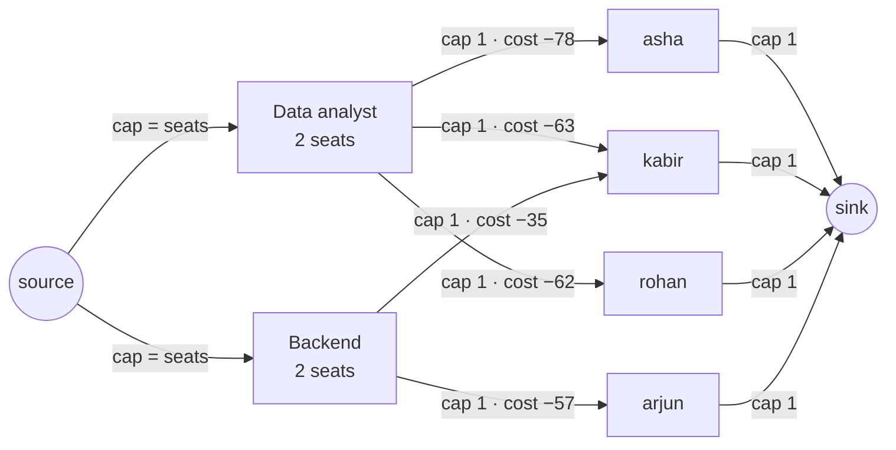

A role → candidate edge exists only when the candidate meets that role's threshold. Capacities
are integers, so the maximum flow is integral: each edge carries 0 or 1, which *is* an
assignment. By max-flow min-cut, no valid assignment fills more seats.

- **Max-flow, Edmonds–Karp.** Ford–Fulkerson with BFS shortest augmenting paths over an
  edge-list residual graph (edge `e` and `e ^ 1` are reverses). It runs in O(V·E²), or O(F·E)
  for small flow F. A warm start from the greedy assignment cuts augmenting paths by about 80%.
- **Min-cost flow (what Notch saves).** Each role → candidate edge costs −(match × 100).
  Successive shortest paths: one **Bellman–Ford** pass (costs are negative), then **Dijkstra with
  a binary heap** on **Johnson-reduced costs** c(u,v) + π(u) − π(v) ≥ 0. The result is the
  cheapest of all maximum flows, which is the best total fit among assignments that fill the
  most seats. Time O(V·E + F·E log V).
- **Greedy (the comparison).** Hand each seat to the highest-scoring candidate still free.

| Candidates | Seats | Greedy fills | Max-flow fills | Max-flow time (greedy start) |
|---:|---:|---:|---:|---:|
| 1,000 | 350 | 297 | **350** | 2.5 ms |
| 10,000 | 3,500 | 2,824 | **3,500** | 61.9 ms |
| 100,000 | 35,000 | 28,301 | **35,000** | 13.6 s |

Greedy leaves about 19% of seats empty because it spends all-rounders on the popular role.

### 2 · Ownership Check planning: greedy weighted set cover

**Problem.** Choose a few code regions to ask about so that, together, they touch **every skill,
every engineering concept and every main file** the repository shows, with as little reading as
possible. That is weighted set cover, which is NP-hard.

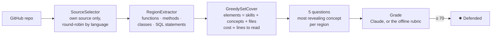

**Greedy rule.** Repeatedly take the region with the lowest *cost per newly covered element*.
Its total cost is at most **H(d) = 1 + ½ + … + 1/d ≤ 1 + ln d** times the optimum, where d is
the most elements any one region covers. With bit sets it runs in O(k · m · u / 64).

| Elements | Regions | Greedy / optimal | Greedy | Exact branch-and-bound |
|---:|---:|---:|---:|---:|
| 20 | 10 | 1.22 | 0.05 ms | 0.9 ms |
| 40 | 18 | 1.08 | 0.05 ms | 13.9 ms |
| 400 | 20,000 | n/a | **9.7 ms** | out of reach |

The unit tests check the H(d) bound against brute force on 300 random instances.

**Grading.** With an Anthropic key, Claude writes and grades the questions. Without one, concept
templates write them and a transparent rubric grades them:
`score = 50% ideas covered + 30% the code's own names used + 20% depth (full at 70 words)`. Pasting,
leaving the page, and typing faster than 120 wpm are recorded and shown to the recruiter, not
silently punished.

### 3 · Percentile badges: randomized Quickselect

"Top 1 / 5 / 10 / 25%" needs the 99th, 95th, 90th and 75th percentile of every skill's scores.
Instead of sorting (O(n log n)), Notch runs **randomized Quickselect with a three-way
partition** (fast on ties). Each cut-off then searches only the part at or below the previous
one, so all four together take **expected O(n)**. Badges need at least 20 peers, and a cut-off
equal to the lowest score is dropped, since tying at the bottom sets no one apart.

| Scores | Quickselect | Full sort | Speed-up |
|---:|---:|---:|---:|
| 100,000 | 4.05 ms | 12.87 ms | 3.2× |
| 1,000,000 | 33.08 ms | 87.48 ms | 2.6× |

The same `RandomizedSelect.topK` picks shortlist top-k, search results, start-here files and
open tasks, in expected O(n + k log k).

### 4 · Copied repositories: Bloom filter + exact check

Each claimed repository has two fingerprints: the SHA of its **first commit** (survives
re-uploads that keep history) and the **tree SHA** of its latest commit (catches a fresh copy).
A Bloom filter over every fingerprint on Notch (sized for 1 M at 1% false positives, about
1.2 MB) answers *definitely new* without touching the database. *Possibly seen* is always
confirmed with an exact lookup, so the filter never decides anything on its own.

- k bit positions by **double hashing**: g<sub>i</sub>(x) = h₁(x) + i·h₂(x) mod m (Kirsch–Mitzenmacher).
- Sizing: m = −n ln p / (ln 2)², k = (m/n) ln 2.
- Measured false-positive rate at 100,000 items: **0.983%** against a theoretical 1.004%, in
  117 KB instead of 6.1 MB of raw hashes.

### 5 · Skill score: noisy-OR with recency decay

Each piece of evidence has a strength e ∈ [0, 1], discounted by age with a 12-month half-life:

$$
\text{score} = 100 \cdot \Bigl(1 - \prod_i \bigl(1 - e_i \cdot 0.5^{\,\text{months}_i / 12}\bigr)\Bigr)
$$

| Evidence | Strength e |
|---|---|
| Repository | 0.85 × (½·min(1, own commits / 50) + ½·min(1, active weeks / 12)) |
| **Defended** repository | same, with the cap raised from 0.85 to **1.0** |
| Project write-up | 0.4 |
| Chat history | up to 0.2, by depth |
| Fork or duplicate | 0 |

More independent proof raises the score with diminishing returns, and order doesn't matter. One
repository alone tops out at 85, so reaching the 90s takes several pieces of work or a defence.
This keeps strong candidates apart instead of tied at 100.

### 6 · Match score and closest fix

$$
\text{match} = \frac{\sum_r w_r \cdot s_r \cdot g_r}{\sum_r w_r}, \qquad g_r = \begin{cases}1 & \text{level} \ge \text{required}\\ 0.5 & \text{otherwise}\end{cases}
$$

A missing must-have makes a candidate ineligible. For near misses, `closestFix` solves for the
one skill whose smallest raise crosses the threshold:
`needed = (threshold − others) · Σw / w_r`. It prefers a pure score raise over a level-up when
the two tie.

### 7 · Constellation layout: force-directed with golden-angle seeding

1. **Areas on an ellipse** in a fixed order, so related areas sit next to each other.
2. **Seed** each area's stars on a **sunflower spiral** (golden angle π(3 − √5)), strongest
   nearest the centre.
3. **Relax for 220 iterations** with cooling: pairwise **repulsion** keeps stars apart,
   **springs** pull skills used together (weight = shared repositories), and a weak pull keeps
   each star near its area.
4. **Fit** to the frame without stretching more than 1.7×. **Labels** are placed greedily,
   strongest first, right / left / above / below, whichever overlaps nothing.

It is deterministic: the same skills always draw the same sky, so a constellation is
recognisably yours.

### 8 · Archetype and trait

Skill scores are summed per archetype through a domain map (Data → Data Storyteller, Databases →
60% Data / 40% Systems, AI & ML → Model Builder…). Languages span every kind, so they don't
count. Fewer than 3 backed skills means **Explorer**. No area above 38% with at least 3 areas at
15% or more means **Polymath**. The trait is the strongest of the commit-time signals:
**Night Owl** (≥ 35% of commits at night), **Early Bird** (≥ 30%), **Weekend Builder** (≥ 40%),
**Steady**, **Sprinter** (8+ commits a week) and **Finisher** (3+ repositories worked on for a
month or more).

### 9 · Search: suffix array + hybrid ranking

The **suffix array** is built by prefix doubling with counting sort in O(n log n) and answers
exact queries in O(m log n). Ranking fuses four signals, each scaled to [0, 1]: exact matches,
cosine similarity from pgvector, exponential recency decay, and whether the chunk is a recorded
decision. Each hit keeps its per-signal contributions for the "why this result" panel.

| Mode | Hit@1 | Hit@5 | MRR@10 |
|---|---:|---:|---:|
| **Hybrid (what Notch does)** | **0.72** | **0.86** | **0.794** |
| Exact only (suffix array) | 0.62 | 0.82 | 0.710 |
| Vector only | 0.34 | 0.36 | 0.345 |

50 labelled questions; full method in [docs/evaluation.md](docs/evaluation.md). The suffix array
is **6,914×** faster than scanning at 100,000 chunks, and incremental union-find absorbs a new
conversation **830,000×** faster than a BFS recompute.

<details>
<summary><b>Complexity summary</b></summary>

| Algorithm | Time | Space |
|---|---|---|
| Edmonds–Karp max-flow | O(V·E²); O(F·E) for small F | O(V + E) |
| Min-cost flow (SSP + Johnson) | O(V·E) + O(F·E log V) | O(V + E) |
| Greedy weighted set cover | O(k·m·u / 64) | O(m·u / 64) |
| Randomized Quickselect top-k | expected O(n + k log k) | O(n) |
| Percentile bands (4 nested selects) | expected O(n) | O(n) |
| Bloom filter add / check | O(k) | m bits |
| Radix tree insert / lookup / complete | O(L) / O(L) / O(p + s) | O(total key length) |
| Suffix array build / query | O(n log n) / O(m log n) | O(n) |
| KMP | O(n + m) | O(m) |
| Union-find | O(α(n)) amortized | O(n) |

</details>

Full benchmark tables: [docs/benchmarks.md](docs/benchmarks.md).

---

## Motion and animation

Motion is plain CSS keyframes and `requestAnimationFrame`, with no animation library. Each
animation marks a moment that matters, and every one respects `prefers-reduced-motion`.

| Moment | What moves | How |
|---|---|---|
| **Constellation reveal** | Stars arrive **strongest first** from 20% scale with a slight overshoot, then the lines **draw themselves** between them, and area names fade in | `arrive` on `cubic-bezier(0.2, 0.8, 0.2, 1.2)` with a per-star `--delay`; `draw` animates `stroke-dashoffset` from each line's length to 0 ([constellation.module.css](web/src/components/read/constellation.module.css)) |
| **The Defended seal** | The seal **presses** onto the page: arrives large and rotated, lands, settles at −8° | `press`: `scale(1.9) rotate(-28deg)` → `scale(0.94)` → `scale(1) rotate(-8deg)` ([seal.module.css](web/src/components/seal.module.css)) |
| **Numbers** | Repositories, skills and weeks **count up** when scrolled into view | `CountUp`: rAF with ease-out cubic `1 − (1 − t)³`. The server renders the final value, so screen readers and no-JS see the real number ([CountUp.tsx](web/src/components/CountUp.tsx)) |
| **Landing demo interview** | A scripted Ownership Check **types its own answer**, grades it, and stamps the seal, with a blinking caret and a replay button | Phased state machine (asking → typing → grading → done) on timers ([Viva.tsx](web/src/app/_landing/Viva.tsx)) |
| **Lists and bars** | Cards **rise** and **pop in** one after another; skill and match bars **grow** from the left | `rise` / `pop-in` / `grow-x`, staggered with `calc(var(--i) * 55ms)` ([globals.css](web/src/app/globals.css)) |
| **The interview clock** | With two minutes left, the clock **pulses** (and is announced to screen readers); each new question slides in | `pulse` (1 s, alternate), `enter` (260 ms) ([interview.module.css](web/src/app/(app)/check/[checkId]/interview.module.css)) |
| **Check preparation** | Each step (fetching files → splitting into regions → choosing parts → writing questions) **pulses** while it runs | `prep-pulse` ([onboarding.module.css](web/src/app/(app)/start/onboarding.module.css)) |
| **Outreach drafting** | While Notch writes a message from the candidate's work, a dot **breathes** | `breathe` ([outreach.module.css](web/src/components/outreach/outreach.module.css)) |

Type is set in Bricolage Grotesque (display), Schibsted Grotesk (text) and Fragment Mono (code),
self-hosted through Fontsource. Light and dark themes switch with a toggle.

---

## Tech stack and architecture

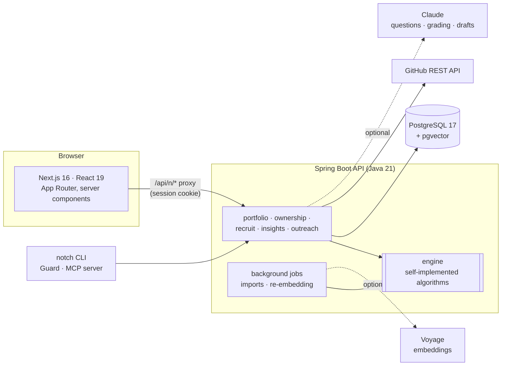

| Layer | Technology |
|---|---|
| **Algorithms** | Plain Java 21, no runtime dependencies (`engine/`) |
| **API** | Spring Boot (Web MVC, JDBC, Validation, Actuator), Flyway migrations |
| **Database** | PostgreSQL 17 with **pgvector** for semantic search |
| **Web** | Next.js 16 (App Router), React 19, TypeScript 5.9, CSS Modules. No UI or animation libraries |
| **AI (optional)** | Anthropic Claude (`claude-haiku-5-5`) for questions, grading, extraction and drafts; Voyage `voyage-4-lite` embeddings. Without keys, everything falls back to offline templates, rubrics and word-hashing embeddings |
| **Auth** | GitHub and Google OAuth, personal access tokens for the CLI, and a guest sign-in for local runs |
| **Security** | AES-256-GCM encryption of content at rest, secret redaction before storage, cross-user isolation tests. Projects marked private are never sent to an AI model |
| **CLI** | One dependency-free jar: Git hooks, Claude Code hooks, an MCP server |
| **CI** | GitHub Actions: Java unit tests and search evaluation, live API tests against Postgres, web tests + build + type-check |

---

## Quality

| Suite | Tests |
|---|---:|
| `engine`: every algorithm, with boundary cases and randomized tests against the baselines | 134 |
| `api`: services, parsers, grading, matching, security | 275 (+ 21 live tests that run against a running API) |
| `cli` | 43 |
| `guard` | 35 |
| `explain` | 20 |
| `web`: layout, syntax highlighting, zip, text | 19 |

The live suites cover the whole product end to end: `WalkthroughSmokeTest` (14 steps) and
`CrossUserIsolationTest`, which proves one user gets a 404 for everything belonging to another.

---

## Repository layout

| Path | What it is |
|---|---|
| [`engine/`](engine/) | Self-implemented algorithms, tests and benchmarks ([engine/README.md](engine/README.md)) |
| [`api/`](api/) | Spring Boot REST API: portfolios, evidence, Ownership Checks, public profiles, drives, shortlists, seat assignment, outreach ([api/README.md](api/README.md)) |
| [`web/`](web/) | Next.js web app, plus a dependency-free mock API for UI work ([web/README.md](web/README.md)) |
| [`cli/`](cli/), [`guard/`](guard/), [`explain/`](explain/) | The `notch` CLI, decision guard and code map |
| [`docs/`](docs/) | Benchmarks, search evaluation, screenshots and the clips above |
| [`samples/`](samples/) | Sample ChatGPT and Claude exports and a sample codebase |

---

## Run it locally

**Prerequisites:** JDK 21, Maven 3.9+, Docker Desktop, Node 20.9+. Optional: `GITHUB_TOKEN` (reads
up to 30 repositories per sync instead of 12), `ANTHROPIC_API_KEY`, `VOYAGE_API_KEY`.

```bash
docker compose up -d                                       # PostgreSQL + pgvector
mvn -q install -DskipTests
mvn -pl api spring-boot:run                                # API on :8090

curl -X POST "localhost:8090/api/dev/demo-pool?size=300"   # 300 sample candidates (local profile)

cd web && npm ci && npm run dev                            # http://localhost:3000
```

**No Java?** `npm run mock-api` and `npm run dev` in `web/` run the whole interface against an
in-memory stand-in with sample candidates.

First time? [`RUNNING.md`](RUNNING.md) walks through setup, the full demo flow and what to do if a
step fails.

### Environment variables

Nothing is required for a local run: the `local` profile has development defaults for every
value. Copy [`.env.example`](.env.example) to `.env` (gitignored) only for real credentials, and
never commit it. The values below are placeholders.

| Variable | Needed for | Example / default |
|---|---|---|
| `SPRING_PROFILES_ACTIVE` | Choose `local` (default for dev) or `cloud` | `cloud` |
| `DATABASE_URL`, `DATABASE_USER`, `DATABASE_PASSWORD` | PostgreSQL | `jdbc:postgresql://localhost:5433/notch` · `notch` · `notch` |
| `NOTCH_CRYPTO_KEY` | AES-256-GCM content key, 32 random bytes in base64 (`openssl rand -base64 32`) | `<base64-key>` |
| `NOTCH_AUTH_SECRET` | Signs OAuth state | `<random-secret>` |
| `NOTCH_CORS_ORIGINS` | Web origins allowed to call the API | `http://localhost:3000` |
| `GITHUB_CLIENT_ID`, `GITHUB_CLIENT_SECRET`, `GITHUB_CALLBACK_URL` | "Continue with GitHub" | `<client-id>` · `<client-secret>` · `http://localhost:8090/auth/github/callback` |
| `GOOGLE_CLIENT_ID`, `GOOGLE_CLIENT_SECRET`, `GOOGLE_CALLBACK_URL` | "Continue with Google" | same pattern |
| `GITHUB_TOKEN` | Optional: 5,000 GitHub calls an hour and 30 repositories per sync instead of 12 | any personal token, no scopes |
| `ANTHROPIC_API_KEY`, `NOTCH_LLM_MODEL` | Optional: Claude writes and grades questions, drafts outreach | `<key>` · `claude-haiku-5-5` |
| `VOYAGE_API_KEY`, `NOTCH_EMBEDDING_MODEL` | Optional: semantic search embeddings | `<key>` · `voyage-4-lite` |
| `NOTCH_MAIL_USER`, `NOTCH_MAIL_PASSWORD` | Optional: email outreach (SMTP, default `smtp.gmail.com:587`) | `<address>` · `<app-password>` |
| `NOTCH_API_URL` (web, [`web/.env.example`](web/.env.example)) | Where the web app's server finds the API | `http://localhost:8090` |

Without the optional keys, Notch runs fully offline: template questions, a rubric grader and
word-hashing embeddings.

### API examples

With the API running in the `local` profile (real responses for each of these, including the
error cases, are in [docs/submission/evidence/api-transcript.md](docs/submission/evidence/api-transcript.md)):

```bash
API=localhost:8090
TOKEN=$(curl -s -X POST $API/auth/dev-login -H 'Content-Type: application/json' \
  -d '{"handle":"recruiter"}' | jq -r .token)            # local profile only
AUTH="Authorization: Bearer $TOKEN"

curl -s -X POST "$API/api/dev/demo-pool?size=300"        # 300 seeded candidates
curl -s "$API/api/skills/autocomplete?q=py" -H "$AUTH"   # radix-tree autocomplete

# A drive from a job description: requirements are read from the text
D=$(curl -s -X POST $API/api/drives -H "$AUTH" -H 'Content-Type: application/json' -d '{
  "title": "Data analyst",
  "description": "Must have strong SQL and Python. Dashboards in Power BI. Statistics is a plus."}' | jq -r .id)
R=$(curl -s $API/api/drives/$D -H "$AUTH" | jq -r '.roles[0].id')

curl -s "$API/api/drives/$D/roles/$R/shortlist?k=5" -H "$AUTH" | jq '.candidates[] | {handle, score}'
curl -s -X POST $API/api/drives/$D/assign -H "$AUTH" \
  | jq '{totalSeats, filled, totalMatch, baselineFilled, baselineMatch}'
curl -s $API/public/profiles/demo-0154 | jq '.skills[] | {name, score, level, topPercent}'

# Errors are RFC 7807 problem details with a stable code
curl -s -X PUT $API/api/drives/$D/roles -H "$AUTH" -H 'Content-Type: application/json' \
  -d '{"roles":[{"name":"Bad","seats":1,"threshold":150,"requirements":[{"skillId":17,"weight":3,"mustHave":true,"minLevel":"VERIFIED"}]}]}'
# → 400 {"code":"invalid_threshold","detail":"Bad: the minimum match must be between 0 and 100.", ...}
```

### Representative test dataset

| Data | Where | Used by |
|---|---|---|
| 300 synthetic public candidates, identical on every machine | `POST /api/dev/demo-pool?size=300` | Shortlists, percentile bands, seat assignment |
| ChatGPT and Claude exports | [`samples/chatgpt-conversations.json`](samples/chatgpt-conversations.json), [`samples/claude-conversations.json`](samples/claude-conversations.json) | Chat-export import, skill suggestions |
| Notes and pasted chats | [`samples/`](samples/) (`billing-notes.md`, `pasted-billing-chat.txt`, …) | Import, Bloom-filter de-duplication, drift alerts |
| A sample codebase | [`samples/billing-service/`](samples/billing-service/) (also zipped) | Code map and review |
| 50 labelled search questions over 89 messages | `api/src/test/resources/eval/` | Search evaluation ([docs/evaluation.md](docs/evaluation.md)) |
| Seeded synthetic generators (seed 2026) | `engine/src/main/java/dev/notch/engine/bench/` | Benchmarks at 10³–10⁶ items |
| Mock API with sample candidates | [`web/scripts/mock-api.mjs`](web/scripts/mock-api.mjs) | Running the whole UI without Java |

### Tests and benchmarks

```bash
mvn test                                       # all Java modules
cd web && npm test && npm run typecheck && npm run build

mvn -q -pl engine compile                      # benchmarks
java -Xmx2500m -cp engine/target/classes dev.notch.engine.bench.BenchmarkRunner
```

---

## Submission documents (CIA 3)

| Deliverable | Document |
|---|---|
| A · Project proposal | [A-proposal.md](docs/submission/A-proposal.md) · [PDF](docs/submission/pdf/A-proposal.pdf) |
| B · Source code repository | This repository (Java backend `api/` + `engine/`, frontend `web/`, tests, `samples/`, `pom.xml`, `web/package.json`) |
| C · Technical report | [C-technical-report.md](docs/submission/C-technical-report.md) · [PDF](docs/submission/pdf/C-technical-report.pdf) |
| D · Demonstration evidence | [D-demo-evidence.md](docs/submission/D-demo-evidence.md) · [PDF](docs/submission/pdf/D-demo-evidence.pdf) · [API transcript](docs/submission/evidence/api-transcript.md) |
| E · README and reproducibility | This README |

---

## Known limitations

- **Edmonds–Karp at scale.** A 100,000-candidate drive takes about 13.5 s. Dinic's algorithm
  would be the next step.
- **Bloom filters can't delete.** After deletions a removed item may test "possibly seen". The
  exact check catches it, and the filter is rebuilt from the database.
- **Secret scanning is a screen.** A low-entropy secret in an unknown format can slip through.
- **Offline grading is a rubric.** Without a model, grading checks ideas, the code's own names
  and depth. It is transparent, but it is not a human interviewer.
