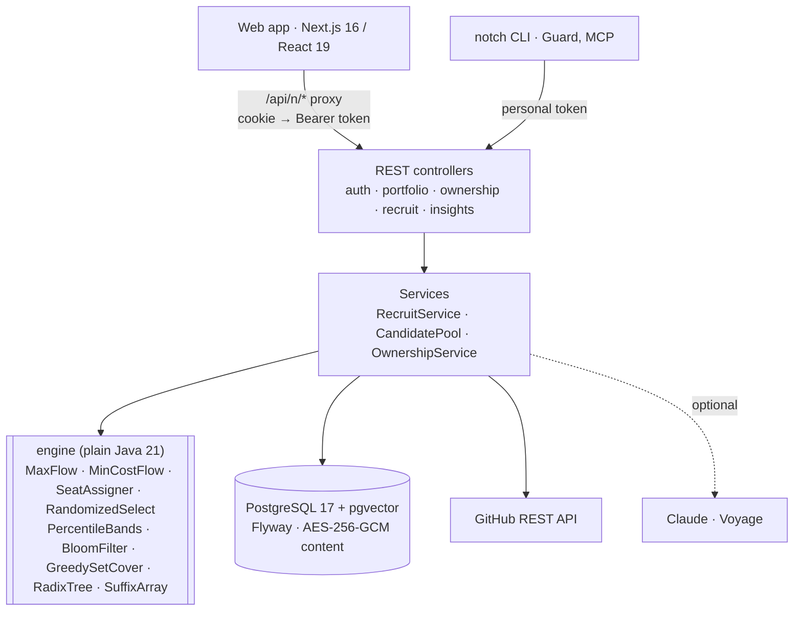
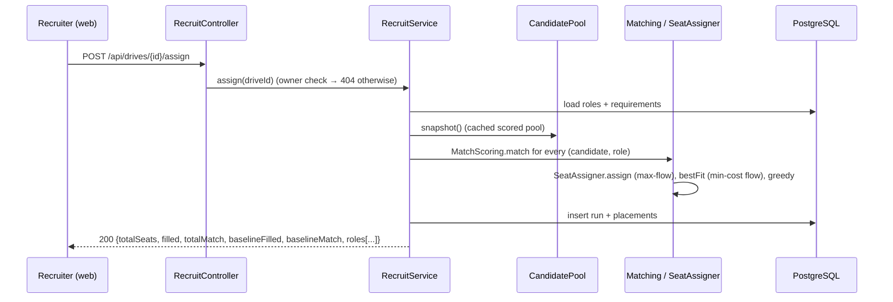
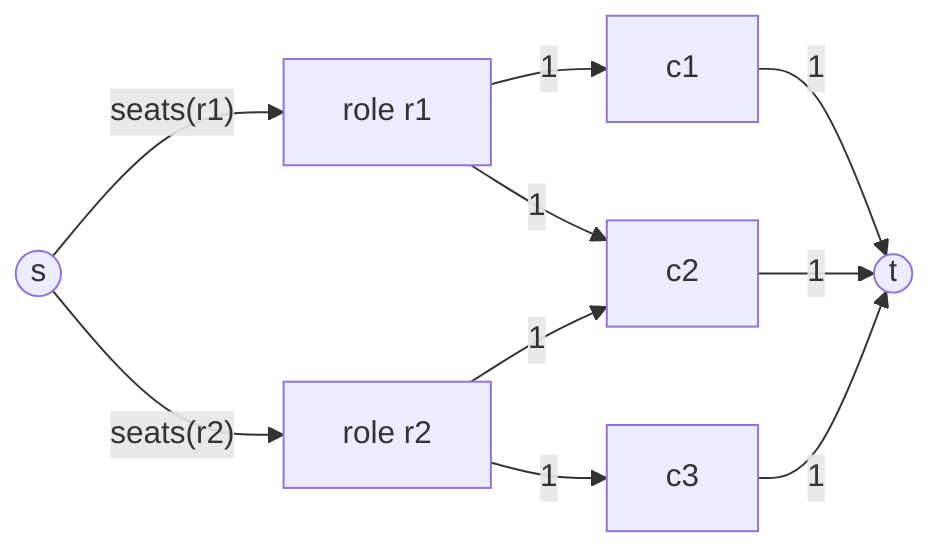
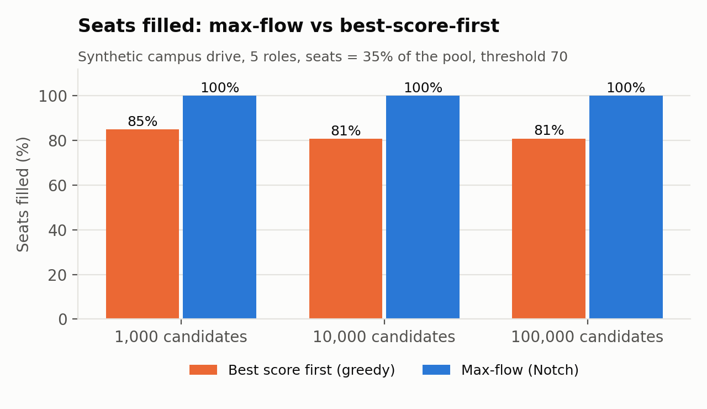
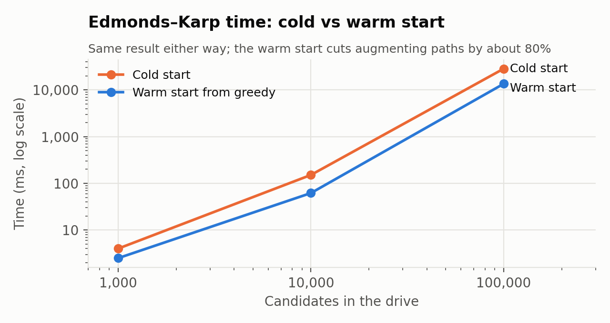
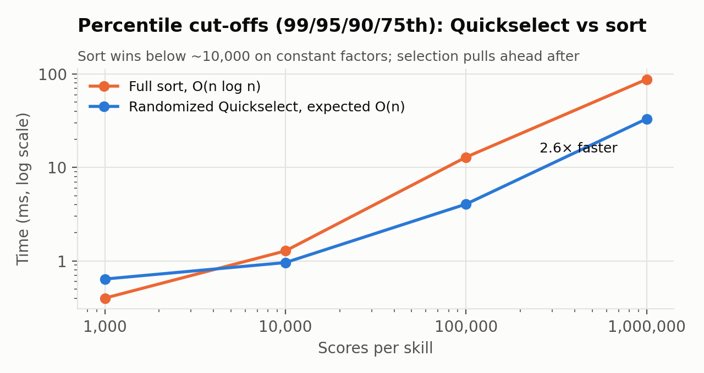
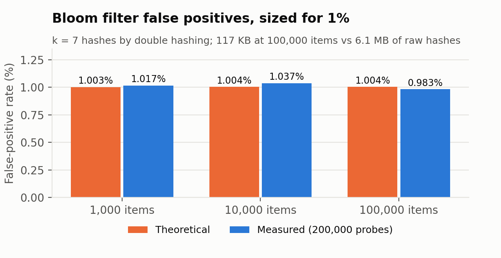

# Notch: Technical Report

**CIA 3, Advanced Algorithms** · Semester V, B.Tech CS (AI & ML), 2026–27 · Dhruvi Jain (2400297)

Repository: `github.com/dhruvi-git/notch` · Core techniques: **network flow** (Unit 5, CO4) and
**randomized algorithms** (Unit 6, CO5)

## 1. Problem statement and constraints

Notch is a portfolio and hiring platform for campus placements. Students' skills are scored from
evidence (GitHub repositories, projects, AI-chat history) and can be *defended* in a timed
interview about their own code. Recruiters paste a job description, get a ranked shortlist, and
assign the seats of a multi-role drive. Two algorithmic problems sit at its centre.

**P1: Seat assignment.** Given roles *R* (each with *seats(r)* and a minimum match
*θ(r)* ∈ [0, 100]), candidates *C*, and match scores *s(c, r)* ∈ [0, 100], choose pairs
(*c*, *r*) with *s(c, r)* ≥ *θ(r)* such that each candidate takes at most one seat and no role
exceeds its seats. Objective: **maximize the number of seats filled**, then **maximize total
match** among assignments that achieve it.

**P2: Percentile badges and top-k.** For every skill, find the 99th, 95th, 90th and 75th
percentile of all candidates' scores (for "Top 1/5/10/25%" badges), and the *k* best candidates
for a role, faster than sorting.

**Constraints.**

| Constraint | Value |
|---|---|
| Candidate pool | Up to 10⁵ for assignment and 10⁶ score values per skill (benchmarked) |
| Roles per drive · seats per role · requirements per role | ≤ 10 · 0–10,000 · 1–15 |
| Latency | Interactive: a 10,000-candidate drive must assign in well under a second |
| Correctness | Assignment must be provably maximum, not heuristic; badges must equal exact percentiles |
| Badge validity | Bands only with ≥ 20 peers for the skill; no band whose cut-off equals the minimum score |
| Data | Public GitHub data only (60 API calls/hour without a token); AI models optional, with offline fallbacks; projects marked private are never sent to a model |
| Implementation | Algorithms written from scratch in Java 21 with no runtime dependencies (`engine/`) |

## 2. System design



The browser never calls the API directly: Next.js route handlers proxy `/api/n/*` and attach the
session token from an HTTP-only cookie. The web app never computes a score or assignment; every
algorithm runs in the API process from the `engine` module.

**Seat-assignment request flow:**



**Main endpoints** (full list in `api/README.md`; real requests and responses in
`docs/submission/evidence/api-transcript.md`):

| Method | Path | Purpose |
|---|---|---|
| POST | `/api/drives` | Create a drive; requirements parsed from the job description |
| PUT | `/api/drives/{id}/roles` | Roles: seats, threshold, requirements (validated) |
| GET | `/api/drives/{id}/roles/{roleId}/shortlist?k=` | Top-k via randomized selection, with score breakdown |
| POST | `/api/drives/{id}/assign` | Seat assignment (P1) |
| GET | `/public/profiles/{handle}` | Skills with score, level and percentile band (P2) |
| POST | `/api/portfolio/github/sync` | Evidence from GitHub, with the Bloom-filter duplicate screen |
| POST | `/api/ownership/checks` | Ownership Check planned by greedy set cover |

Errors are RFC 7807 problem details (`status`, `title`, `detail`, a stable `code`). A resource
belonging to another user returns **404, not 403**, so identifiers reveal nothing.

## 3. Technique 1: network flow for seat assignment

### 3.1 Model

Build a network with source *s*, sink *t*, one node per role and one per candidate:

* *s → r* with capacity *seats(r)*;
* *r → c* with capacity 1 **only if** *s(c, r)* ≥ *θ(r)* (added in decreasing score order);
* *c → t* with capacity 1.



### 3.2 Pseudocode

The residual graph is an edge list where edge *e* and *e* ⊕ 1 are mutual reverses.

```text
EDMONDS-KARP(G, s, t)                          // engine/flow/MaxFlow.java
  flow ← 0
  loop
    parent ← BFS(s) over edges with cap[e] > 0, stopping when t is reached
    if t not reached: return flow              // no augmenting path ⇒ maximum
    b ← min cap[e] over edges e on the s–t path
    for each edge e on the path:
      cap[e] ← cap[e] − b ;  cap[e ⊕ 1] ← cap[e ⊕ 1] + b
    flow ← flow + b

ASSIGN(roles, candidates, s(·,·), warmStart)     // engine/flow/SeatAssigner.java
  build the network of §3.1
  if warmStart:
    for each (c, r) in GREEDY(roles, s): push 1 unit along s→r→c→t
  EDMONDS-KARP(G, s, t)
  return {(c, r) : flow(r → c) = 1}

GREEDY(roles, s)
  P ← all eligible pairs (c, r), sorted by s(c, r) descending
  for (c, r) in P: if c unused and r has a free seat: take (c, r)

MIN-COST-MAX-FLOW(G, s, t)                     // engine/flow/MinCostFlow.java
  π ← BELLMAN-FORD(s)                          // costs may be negative; no negative cycle
  loop
    dist, parent ← DIJKSTRA(s) with reduced costs c(u,v) + π(u) − π(v) ≥ 0  (binary heap)
    if dist[t] = ∞: return (flow, cost)
    π(v) ← π(v) + dist(v) for every reached v
    augment the bottleneck b along the path; cost ← cost + b · Σ c(e)

BEST-FIT(roles, candidates, s)                 // what Notch saves
  same network, cost(r → c) = −round(100 · s(c, r)), other edges cost 0
  MIN-COST-MAX-FLOW(G, s, t)
```

### 3.3 Correctness

1. **Flows are assignments.** All capacities are integers and every augmentation pushes an
   integral bottleneck, so the final flow is integral. Then every *r → c* edge carries 0 or 1;
   *c → t* (capacity 1) gives each candidate at most one seat; *s → r* (capacity *seats(r)*) never
   over-fills a role; and an *r → c* edge exists only when *s(c, r)* ≥ *θ(r)*. Conversely, any
   valid assignment is a feasible integral flow of value equal to the seats it fills. The flow
   value therefore equals the seats filled, and a maximum flow is a maximum assignment.
2. **Edmonds–Karp returns a maximum flow.** It stops only when the residual graph has no *s–t*
   path. By the **max-flow min-cut theorem**, the flow then equals the capacity of the cut
   (vertices reachable from *s*, the rest) and is maximum. Because each path is a BFS shortest
   path, residual distances never decrease, giving at most O(*V·E*) augmentations, so the
   algorithm terminates.
3. **The warm start is sound.** Greedy only takes (*c*, *r*) when *c* is unused and *r* has a free
   seat, so pushing one unit along each *s → r → c → t* respects every capacity and conserves flow.
   Ford–Fulkerson's argument holds from any feasible flow, so the result is still maximum. The
   benchmark asserts that cold and warm starts fill the same number of seats.
4. **Min-cost flow gives the best fit.** Successive shortest paths keep the invariant *"the
   current flow is a cheapest flow of its value"*, which holds exactly when the residual graph
   has no negative-cost cycle. The initial network is acyclic, so Bellman–Ford is valid; after it,
   the Johnson potentials make every residual reduced cost non-negative. Dijkstra is then
   correct, and updating π by the new distances preserves this on the edges an augmentation
   opens. At termination the flow is maximum and the cheapest among maximum flows. With
   cost = −100·score, that is the **highest total match among assignments that fill the most
   seats** (to 0.01 of a point).
5. **Tested.** `MaxFlowTest` compares against brute-force minimum cuts on random small graphs;
   `SeatAssignerTest` compares against brute-force enumeration on random drives (11 tests);
   `MinCostFlowTest` checks cheapest routing, re-routing of earlier flow when that is cheaper overall, and rejection of negative cycles.

### 3.4 Complexity

| Step | Time | Space |
|---|---|---|
| Build network | O(Σ eligible pairs + *R* + *C*) | O(*V* + *E*) |
| Edmonds–Karp | O(*V·E*²) in general; O(*F·E*) since every augmentation adds ≥ 1 and *F* ≤ total seats | O(*V* + *E*) |
| Warm start | Greedy O(*E* log *E*); then O(*E* · (optimum − greedy)) augmenting work | O(*V* + *E*) |
| Min-cost flow | O(*V·E*) Bellman–Ford + O(*F* · *E* log *V*) | O(*V* + *E*) |

Here *V* = *R* + *C* + 2 and *E* = *R* + *C* + (eligible pairs).

## 4. Technique 2: randomized algorithms

### 4.1 Randomized Quickselect with three-way partitioning

```text
SELECT(a, lo, hi, k)                           // engine/select/RandomizedSelect.java
  while lo < hi:
    p ← a[uniform random index in lo..hi]
    partition a[lo..hi] into  [lo, lt) < p ,  [lt, gt] = p ,  (gt, hi] > p   (Dutch flag)
    if k < lt:  hi ← lt − 1
    elif k > gt: lo ← gt + 1
    else: return p                              // k falls in the block equal to p
  return a[k]

TOP-K(items, k)
  SELECT on the descending order for position k − 1;  sort a[0..k−1];  return it

PERCENTILE-BANDS(scores)                       // engine/score/PercentileBands.java
  if |scores| < 20: return no bands
  a ← copy(scores);  hi ← n − 1;  min ← min(scores)
  for b in (1%, 5%, 10%, 25%):                  // tightest first, so ranks decrease
    k ← ⌈(100 − b)/100 · n⌉ − 1                  // nearest-rank 99th, 95th, 90th, 75th percentile
    cut[b] ← SELECT(a, 0, hi, k);  if cut[b] = min: drop band b
    hi ← k                                       // next rank lies in a[0..k]
```

**Correctness.** The partition invariant holds after each pass: every element left of *lt* is
smaller than *p* and every element right of *gt* is larger. The element a full sort would put at
index *k* therefore lies in the segment that contains *k*, and the loop keeps exactly that
segment. If *k* is in the equal block, *p* is the answer. For the bands: after SELECT returns rank
*k*, `a[0..k]` holds the *k*+1 smallest values (in some order), and the next rank is ≤ *k*, so
searching only `a[0..k]` is valid. `PercentileBandsTest` and `RandomizedSelectTest` compare every
result with a full sort on hundreds of seeded random inputs, including heavy ties.

**Expected complexity.** With a uniform pivot, the kept segment has expected size at most ¾ of
the current one, giving expected comparisons T(n) ≤ n + T(3n/4) ≤ 4n, so **expected O(n)** for any
input order. The O(n²) worst case occurs with vanishing probability, and the three-way partition
removes all copies of the pivot at once, so ties cannot cause it. The four bands cost at most
4·(n + 0.99n + 0.95n + 0.90n) expected comparisons, which is O(n) against O(n log n) for sorting.
TOP-K is expected O(n + k log k). Space: O(n) for one copy.

### 4.2 Bloom filter for the copied-repository screen

Each claimed repository has two fingerprints: its first-commit SHA and its latest tree SHA.
A Bloom filter over all fingerprints answers "definitely new" or "possibly seen":

```text
ADD(x):            for i in 0..k−1: set bit (h1(x) + i·h2(x)) mod m     // Kirsch–Mitzenmacher
MIGHT-CONTAIN(x):  return all k bits set
SCREEN(repo):      if no fingerprint MIGHT-CONTAIN → new (no DB access)
                   else confirm with an exact DB lookup; unconfirmed = counted false positive
```

**Correctness.** Bits are only ever set, so there are **no false negatives**. Every "possibly
seen" is confirmed exactly, so the final decision is always exact; the filter only saves work.
With *n* items, *m* bits and *k* hashes, the false-positive rate is ≈ (1 − e^(−kn/m))^k, minimized
at *k* = (m/n) ln 2 with m = −n ln p / (ln 2)². For *p* = 1% this gives 9.59 bits per item and
*k* = 7. **Complexity:** O(k) per operation and m bits of space. Production sizing is 10⁶
fingerprints in about 1.2 MB.

## 5. Supporting techniques

| Feature | Technique | Guarantee / complexity |
|---|---|---|
| Ownership Check question plan | Greedy weighted set cover (elements: skills, concepts, files; cost ∝ lines) | ≤ H(d) ≤ 1 + ln d × optimum; O(k·m·u/64) with bit sets |
| Skill score | Noisy-OR, 100·(1 − Π(1 − eᵢ·0.5^(monthsᵢ/12))); one repository capped at 0.85, defended 1.0 | O(e) |
| Match score | Σ w·s·g / Σ w, g = 1 or 0.5 by evidence level; missing must-have ⇒ ineligible | O(r) |
| Skill autocomplete | Radix tree with weighted completions | O(L) insert/lookup |
| Search, drift alerts, secret redaction | Suffix array (prefix doubling), KMP, Shannon entropy | O(n log n) build, O(m log n) query; O(n + m) |
| Related sessions, code-map areas | Union-find, union by rank + path halving | O(α(n)) amortized |

## 6. Benchmark methodology and results

**Method.** `engine/.../bench/BenchmarkRunner` (Java 21) times each algorithm against its
straightforward baseline (`baseline/Baselines`) at 10³–10⁶ items. Each measurement is the
**median of 5 timed runs after 2 warm-up runs** (index builds: 1 + 3; the 10⁵ seat drive: 3 runs,
cold start 1), with data from seeded generators (**seed 2026**), so every run sees identical
inputs. The seat-assignment drive has 5 roles with seats for 10%, 10%, 5%, 5% and 5% of the pool
and threshold 70. A fifth of candidates are all-rounders who qualify everywhere and score highest
on the popular role; the rest are specialists for role 0 or 1, so roles 2–4 can only be filled
by all-rounders. This is the structure that defeats greedy. Smallest sizes are noisy because the
JIT is still warming. Full tables: `docs/benchmarks.md`.



| Candidates | Seats | Greedy filled | Max-flow filled | Greedy | Max-flow cold | Max-flow warm | Paths cold / warm |
|---:|---:|---:|---:|---:|---:|---:|---:|
| 1,000 | 350 | 297 | **350** | 1.9 ms | 4.0 ms | 2.5 ms | 350 / 53 |
| 10,000 | 3,500 | 2,824 | **3,500** | 9.4 ms | 151.2 ms | 61.9 ms | 3,500 / 676 |
| 100,000 | 35,000 | 28,301 | **35,000** | 48.8 ms | 28.5 s | 13.6 s | 35,000 / 6,699 |



Max-flow fills **every** seat while greedy leaves **~19%** empty. The warm start cuts augmenting
paths by ~80% and time by 50–60% with an identical result. A 10,000-candidate drive assigns in
**62 ms**. At 10⁵ the 13.6 s run is the practical limit of Edmonds–Karp (§7).



| Scores | Quickselect | Full sort | Speed-up |
|---:|---:|---:|---:|
| 1,000 | 0.64 ms | 0.40 ms | 0.6× |
| 10,000 | 0.96 ms | 1.28 ms | 1.3× |
| 100,000 | 4.05 ms | 12.87 ms | 3.2× |
| 1,000,000 | 33.08 ms | 87.48 ms | 2.6× |

Below ~10⁴ the JDK's tuned dual-pivot sort wins on constant factors; from there the expected
O(n) selection pulls ahead, as predicted. Top-k (20 of n) is 10.8×, 5.0× and 12.3× faster than a
full sort at 10³, 10⁴ and 10⁵.



| Items | Bits | k | Theoretical FPR | Measured FPR (2·10⁵ probes) | Filter | Raw 64-byte hashes |
|---:|---:|---:|---:|---:|---:|---:|
| 1,000 | 9,586 | 7 | 1.003% | 1.017% | 1.2 KB | 62.5 KB |
| 10,000 | 95,851 | 7 | 1.004% | 1.037% | 11.7 KB | 625.0 KB |
| 100,000 | 958,506 | 7 | 1.004% | 0.983% | 117.0 KB | 6.1 MB |

**On the real API** (300-candidate seeded pool, 3 roles, 35 seats; evidence transcript §15):
min-cost flow filled **24** seats with total match **1,414.22**, against greedy's **22** and
**1,329.20**. Only 8 candidates meet the Data analyst bar, so 35 seats cannot all be filled.

**Success criteria (proposal §6):** (1) 100% vs 81–85%, met; (2) 62 ms < 100 ms, met; (3)
brute-force agreement in tests, met; (4) exact cut-offs, 3.2× at 10⁵, met; (5) measured FPR within
0.04 pp of target in under 2% of the raw-hash memory, met; (6) H(d) bound on 300/300 instances, 9.7 ms at
20,000 regions, met; (7) 507 Java tests and 19 web tests pass in CI; (8) cross-user isolation
test passes.

## 7. Limitations

* **Edmonds–Karp at 10⁵.** 13.6 s with a warm start. Dinic's algorithm (blocking flows,
  O(E√V) on unit-capacity bipartite graphs) or Hopcroft–Karp on the seat-expanded graph is the
  next step.
* **Min-cost flow's objective** uses scores rounded to hundredths; ties beyond that are broken by
  edge order.
* **Quickselect's worst case** is O(n²) with negligible probability; a median-of-medians fallback
  would make it deterministic.
* **Bloom filters cannot delete.** After deletions a removed fingerprint may test "possibly
  seen"; the exact check catches it, and the filter is rebuilt from the database.
* **Scores reflect evidence, not ability.** Public GitHub data misses private and team work, and
  the offline Ownership Check grader is a transparent rubric, not a human interviewer.
* **Synthetic data.** Benchmarks and the demo pool are synthetic; real drives may have different
  eligibility structure.

## 8. Individual contributions

This is a **solo project**. Dhruvi Jain (2400297) is responsible for all of it: problem framing,
choice and implementation of the algorithms in `engine/`, the Spring Boot API, the Next.js web
app, the CLI, tests and benchmarks, and this report. Development used **Claude Code** (an AI
coding assistant) as a pair programmer. Earlier commits made under the local identity
`Notch <dev@notch.local>` are mapped to the author by `.mailmap`.
