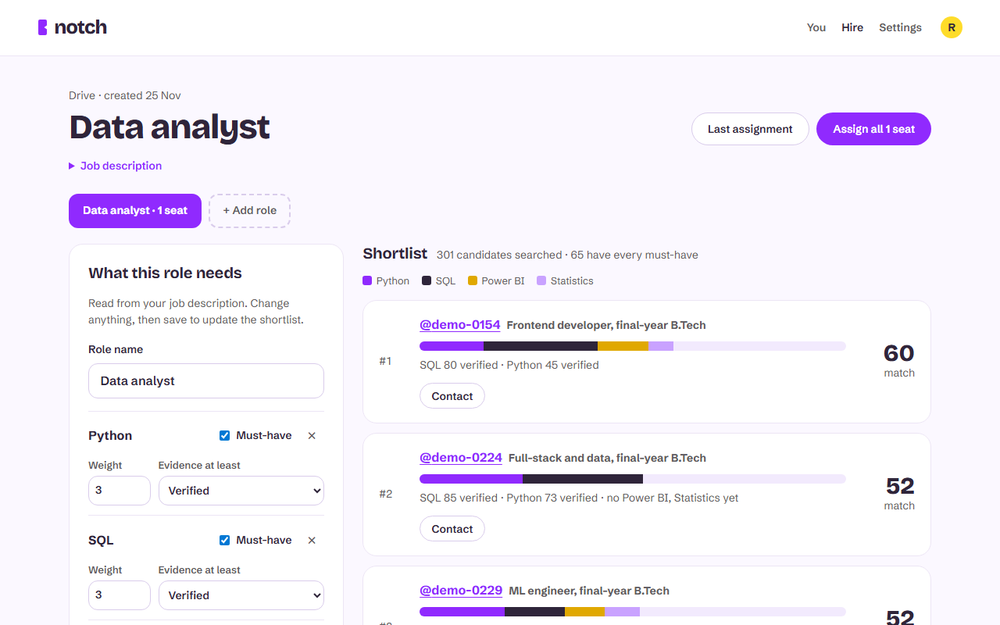
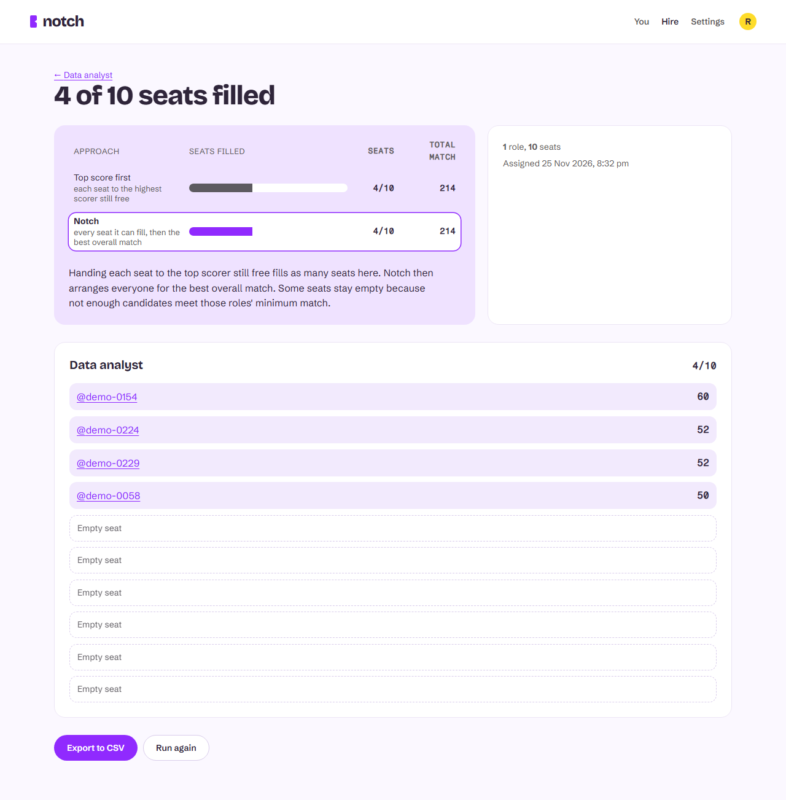
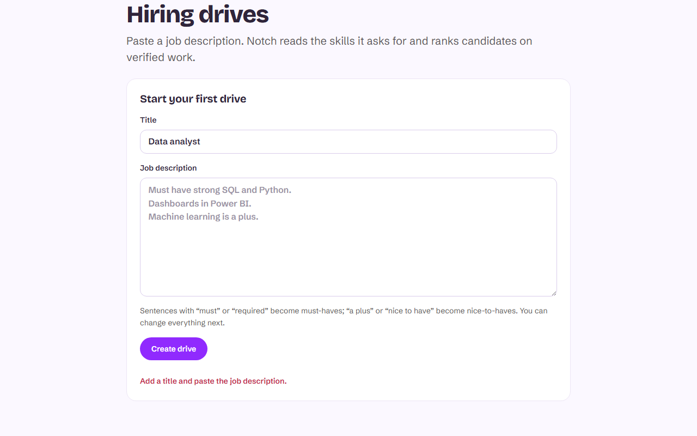
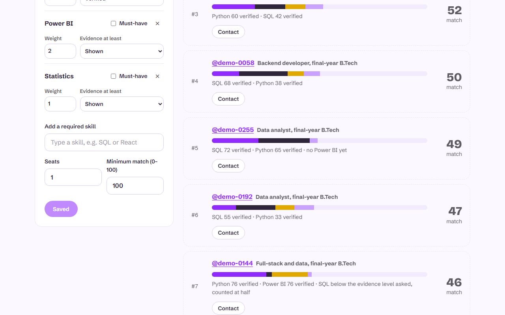
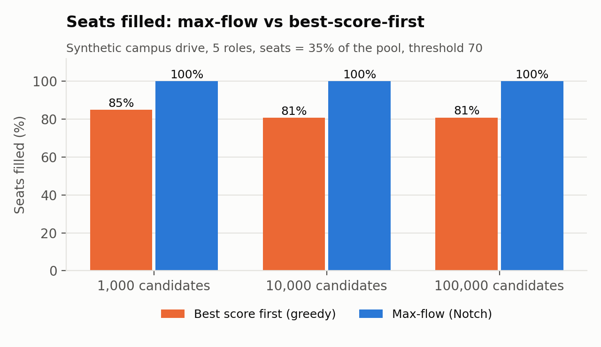
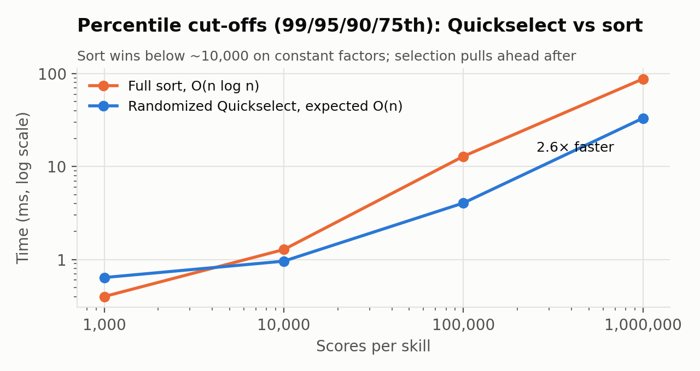

# Notch: Demonstration Evidence

**CIA 3, Advanced Algorithms** · Dhruvi Jain (2400297) · captured 25 November 2026

Everything here can be regenerated:

| What | Script | Needs |
|---|---|---|
| API inputs and outputs, including errors | `docs/submission/capture_evidence.py` | API running locally (local profile) |
| Screenshots of the web app on the real API | `docs/submission/capture_screens.py` | API + web app |
| Performance charts | `docs/submission/make_charts.py` | Python + matplotlib |
| Benchmark tables | `engine/.../bench/BenchmarkRunner` | JDK 21 |

## 1. Working application

Notch runs locally with `docker compose up -d`, `mvn -pl api spring-boot:run` and `npm run dev`
in `web/` (see README, *Run it locally*). The animated walkthroughs in the README
(`docs/media/*.gif`) show the full student and recruiter flows: connecting GitHub, the
constellation, an Ownership Check ending in the Defended seal, and a two-role drive where
max-flow fills 4 of 4 seats and best-score-first fills 3. Those clips use the bundled mock API so
they can be re-recorded without keys. The screenshots below are from the **real Spring Boot API
with PostgreSQL** and its seeded pool of 300 candidates.

*A drive created from "Must have strong SQL and Python. Dashboards in Power BI. Statistics is a
plus.": Python and SQL became must-haves (weight 3, Verified), Power BI weight 2 and Statistics a
nice-to-have (weight 1). The shortlist ranks the eligible candidates of the 301-person pool, and
each bar shows every skill's share of the match.*

*Assigning 10 seats for one role: only 4 candidates reach the minimum match of 50, so both
approaches fill 4 and reach the same total (214). With a single role, greedy is already optimal.
The multi-role case where max-flow wins is in §2.3.*

## 2. Example inputs and outputs

All from `evidence/api-transcript.md` (35 real requests; session tokens redacted).

### 2.1 Job description → requirements (`POST /api/drives` → 201)

| Input sentence | Output requirement |
|---|---|
| "Must have strong SQL and Python." | SQL, Python: weight 3, must-have, min level Verified |
| "Dashboards in Power BI." | Power BI: weight 2, min level Shown |
| "Statistics is a plus." | Statistics: weight 1, nice-to-have |

### 2.2 Shortlist with explanation (`GET …/shortlist?k=5` → 200)

Of a pool of 301, **65** candidates are eligible. The top one, `@demo-0154`, scores **59.6** =
Σ w·s·g / Σ w, with contributions Python 15.03 (45.1, Verified), SQL 26.77 (80.3, Verified),
Power BI and Statistics making up the rest. The same candidate's public profile shows **SQL
80.3, Verified, top 5%** and **Power BI 53.6, top 25%**: percentile bands found by randomized
Quickselect over the whole pool.

### 2.3 Seat assignment across three roles (`POST /api/drives/{id}/assign` → 200)

Input: Data analyst (15 seats), ML engineer (10) and Backend (10), each with minimum match 50.

| | Seats filled | Total match |
|---|---:|---:|
| Best score first (greedy) | 22 / 35 | 1,329.20 |
| **Notch (min-cost max-flow)** | **24 / 35** | **1,414.22** |

Max-flow fills 2 more seats because it moves candidates to the roles only they can fill. The
response marks those candidates with `"moved": true`.

### 2.4 Bringing in AI memory (`POST /api/portfolio/memory-import` → 200)

Input: an assistant's reply with Markdown bold headings, as ChatGPT would send it, listing Python
(USED), SQL (USED), Power BI (LEARNING), Kubernetes (ASKED), a made-up "Quantum Basket Weaving",
one project and a goal. Output: four catalogue skills and the project, added **unapproved**;
`"unrecognised": ["Quantum Basket Weaving"]` (reported, not guessed); goal "Data analyst". The
student's read then names the archetype **"The Data Storyteller"**: "90% of your proven skill is
in data and databases: PostgreSQL, Power BI and SQL."

## 3. Error handling

### 3.1 API (all real responses, RFC 7807 problem details)

| # | Situation | Status | Response `code` / `detail` |
|---|---|---|---|
| 26 | Invalid or revoked token | **401** | `invalid_token`: "Your session has expired or the token was revoked. Sign in again." |
| 27 | Drive with a blank job description | **400** | "Invalid request content." (bean validation) |
| 28 | Malformed JSON body | **400** | "Failed to read request" |
| 29 | Drive id that does not exist | **404** | `not_found`: "That drive was not found." |
| 30 | **Another user's drive** | **404** | Same as a missing drive, so ids reveal nothing (cross-user isolation) |
| 31 | Minimum match of 150 | **400** | `invalid_threshold`: "Bad: the minimum match must be between 0 and 100." |
| 32 | Negative seats | **400** | `invalid_seats`: "seats must be between 0 and 10,000." |
| 33 | Path id that is not a UUID | **400** | Bad Request |
| 34 | Ownership Check on a project instead of a repository | **400** | `not_a_repository`: "Ownership Checks are about code: pick one of your GitHub repositories." |
| 36 | A role with no required skills | **400** | `invalid_requirements`: "Empty role: add between 1 and 15 required skills." |
| 37 | Public profile that does not exist | **404** | `not_found`: "A public profile called @no-such-person-xyz was not found." |
| 35 | A "chat export" that is not one | 200 | Handled gracefully: read as plain text, no skills suggested |
| 25 | No token (local profile only) | 200 | The local profile falls back to a development user by design (`dev-fallback: true`); the default and cloud profiles return 401 |

Beyond these, the live `CrossUserIsolationTest` (7 tests) runs in CI against PostgreSQL and checks
that one user gets 404 for every resource belonging to another.

### 3.2 Web app

*Creating a drive without a description: the form stays filled in and explains what is missing.*

*Typing 150 into "Minimum match": the field clamps to 100 before anything is sent (the API also
rejects 150, §3.1 #31).*

*A profile that does not exist, isn't public, or belongs to another account gets the same page, so
nothing is revealed.*

Other handled cases visible in the product: API unreachable at sign-in ("Sign-in is unavailable
for a moment"), a retake of an Ownership Check within 24 hours (409 `retake_later`), answers
after the deadline (409 `check_finished`), and pasting, leaving the page or typing faster than
120 words per minute during a check, which are recorded and shown to the recruiter.

## 4. Performance

Charts and full tables are in the technical report (§6) and `docs/benchmarks.md`. Summary:

| Algorithm vs baseline | Size | Result |
|---|---:|---|
| Max-flow vs best-score-first: seats filled | 10⁵ candidates | **100% vs 81%** |
| Max-flow with warm start | 10⁴ candidates | **62 ms** |
| Percentile bands: Quickselect vs sort | 10⁶ scores | **33 ms vs 87 ms** (2.6×) |
| Top-20: Quickselect vs sort | 10⁵ scores | **12.3×** faster |
| Bloom filter false positives (target 1%) | 10⁵ items | **0.983%** in 117 KB |
| Set cover plan, greedy | 20,000 regions | **9.7 ms**, within 22% of optimum on small instances |
| Suffix array vs scan | 10⁵ chunks | **6,914×** faster per query |
| Hybrid search vs exact only | 50 labelled questions | MRR@10 **0.794 vs 0.710** |

## 5. Tests

| Suite | Tests | Result (25 Nov 2026) |
|---|---:|---|
| engine | 134 | all pass |
| api | 275 (+ 21 live, run in CI against PostgreSQL) | all pass |
| cli · guard · explain | 43 · 35 · 20 | all pass |
| web (`npm test`) | 19 | all pass; type-check and production build succeed |
